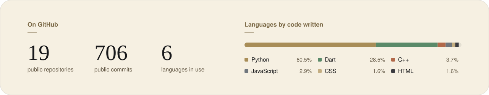

<picture>
  <source media="(prefers-color-scheme: dark)" srcset="assets/readme/banner-dark.svg">
  
</picture>

## About me

I'm a Software Engineering student at FAST-NUCES Faisalabad who builds GenAI systems end to end: the retrieval and agents, the FastAPI service around them, and the Flutter app people actually touch. My RAG chatbot, [CiteRAG](https://github.com/f243077-cell/Cited-RAG-Project), checks every citation in code and reached 92% hit@5 with 681 offline tests. Right now I'm fine-tuning a Qwen2.5 prompt-injection guard for Roman Urdu with QLoRA, and co-building OnCallPilot, an AI incident copilot where a human approves every action.

In August 2026 I finished an eight-week remote Flutter internship at FlutterCraft.app, and I take freelance Flutter work on [Upwork](https://www.upwork.com/freelancers/~010abcc56cc81a152c) alongside my degree. I'm open to GenAI and Flutter roles, remote or on-site, in Pakistan, Dubai and Germany.

| Role                        | Organization                                                     | When                      |
| :-------------------------- | :--------------------------------------------------------------- | :------------------------ |
| Freelance Flutter Developer | [Upwork](https://www.upwork.com/freelancers/~010abcc56cc81a152c) | Ongoing                   |
| Flutter Developer Intern    | FlutterCraft.app (remote)                                        | Jul – Aug 2026, completed |
| BS Software Engineering     | FAST-NUCES Faisalabad                                            | 2024 – 2028               |

## Projects

Badge key:   

### GenAI engineering

#### [CiteRAG](https://github.com/f243077-cell/Cited-RAG-Project): a RAG chatbot whose citations are checked by code

   

Ask questions about your own PDFs, Markdown and images, and every quoted passage in the answer is fuzzy-matched against its source page by code, with one corrective retry and a visible warning on any remaining doubt. Retrieval is LlamaIndex hybrid search over Chroma and a BM25 docstore. It answers in three modes: Standard, Deep (a three-agent CrewAI crew) and Agent (a LangGraph agent that plans, searches with tools and reflects). A semantic cache on NumPy and SQLite serves a repeated question in about 0.1 s instead of about 10 s, and a read-only MCP server exposes the same tools to any MCP client. Hit@5 was measured on an AI-reviewed golden set, so treat it as provisional.

Python · FastAPI · Streamlit · LlamaIndex · Chroma · LangChain · LangGraph · CrewAI · MCP · OpenRouter · Docker Compose

#### [OnCallPilot](https://github.com/f243077-cell/OneCallPilot): a mobile AI incident copilot with a human in the loop

  

An agent investigates alerts with read-only tools, ranks up to three root causes that cite stored evidence, and proposes one action from a fixed catalogue. Nothing runs until a person approves it. I own the acting and display stream: the Flutter Android app for evidence review and biometric approval, the isolated runner that executes approved actions, and Chaos Shop, a testbed with eight fault scenarios. The safety model is strict: the LLM never touches infrastructure, approvals are signed and single-use, and the runner re-validates every action and can only start, stop or restart allowlisted containers. It will be judged by a 48-run benchmark (manual against copilot) on time to diagnosis, with zero unsafe actions allowed.

Python · FastAPI · Flutter · Supabase (Postgres, pgvector) · Redis Streams · Docker

#### [RU-Guard](https://github.com/f243077-cell/Roman-Urdu-Guard-Model): a fine-tuned prompt-injection guard for Roman Urdu

  

Fine-tuning Qwen2.5-0.5B and 1.5B Instruct with QLoRA to catch prompt injection in Roman Urdu, English and mixed text, then serving it locally as a FastAPI guard service on Ollama (GGUF). The data came from Qwen2.5-14B-Instruct-AWQ on Colab: 4,004 training and 496 validation rows. I threw away the first version after a 200-row review found 24% bad rows, and rebuilt it with stricter prompts and an LLM judge. A 300-row test set sits behind a SHA-256 lock so it's never trained or tuned on, and a reference LangGraph RAG app runs guard checks at input, retrieval, ingest and output.

Qwen2.5 · QLoRA · Hugging Face · FastAPI · Ollama · LangGraph · Google Colab

### Full-stack and mobile

#### [PlayGrid](https://github.com/f243077-cell/nasconhackathon): multi-sport league and club platform

  

Built by a team of three over the two days of the NaSCon '26 App Dev Competition, where we finished in the top 4. I led the backend, infrastructure and integration. A FastAPI service computes scores from an append-only event stream in PostgreSQL, Redis handles rate limiting, domain events and realtime pub/sub, and MinIO stores PDF receipts and match recordings. Fixtures generate in four formats, and MediaMTX ingests streams over RTMP and WebRTC and serves them as HLS. The Flutter Android app queues changes offline and syncs on reconnect. Score updates reached 25 WebSocket clients at a 41 ms p95.

Flutter · Riverpod · FastAPI · PostgreSQL · Redis · MinIO · MediaMTX · WebSocket · Docker Compose

#### [BioGuard](https://github.com/f243077-cell/BioGuard): cold-chain compliance for vaccines, insulin and biologics

Simulated fridge sensors publish temperature and lock readings over MQTT (QoS 1) to a FastAPI backend, which re-checks every reading against that device's own thresholds before opening, escalating or resolving an alert. Alerts reach the Flutter app live over WebSocket and Firebase Cloud Messaging, and the app covers JWT auth, a multi-device dashboard, trend charts and PDF compliance reports.

FastAPI · Flutter · Riverpod · MQTT (Mosquitto) · WebSocket · Firebase Cloud Messaging · SQLite · Docker Compose

#### [AcadAI Buddy](https://github.com/f243077-cell/AcadAi_Buddy): AI study companion for university students

Subject-aware AI chat, MCQ quizzes generated and scored on the spot, and summaries from pasted text or a photo of your notes, across 40+ subjects including every FAST-NUCES core course. Four Clean Architecture layers keep Firebase and OpenRouter behind abstract repositories, with failures returned as `dartz` `Either` values, so the UI never knows which model provider it's talking to.

Flutter · Riverpod · Firebase Auth · Cloud Firestore · OpenRouter · go_router · Clean Architecture

#### [CreateResume AI](https://github.com/f243077-cell/CreateResume-AI-App): plain-language input to ATS-ready resume

Describe your background in plain language and it drafts an ATS-optimized resume, optionally tailored to a job description, rendered as a PDF in five templates. Generation runs in a Supabase Edge Function that calls OpenRouter, so the API key never ships inside the app, and each generation draws on a per-user credit balance behind free and premium plans.

Flutter · Riverpod · Supabase (Auth, Postgres, Storage, Edge Functions) · OpenRouter · go_router

#### [FounderAI](https://github.com/f243077-cell/Founder_AI): AI startup assistant

Built at the Google Developer Groups "Build with AI" hackathon.

Node.js · Express · Render

### Computer science fundamentals

- **[Console Social Media Platform](https://github.com/f243077-cell/Mini_Instagram_App)**: built with no STL containers in a team of two. A hash table holds users, a graph with BFS and DFS holds friendships, linked lists hold feeds, and an AVL tree drives top-K analytics. C++ · data structures
- **[UniDisc](https://github.com/f243077-cell/Discrete-University-Management-System)**: course scheduling, prerequisites and enrollment modelled with predicate logic, set and relation analysis, and dynamic programming for conflict detection. C++ · Java · discrete mathematics
- **[Console Chess Engine](https://github.com/f243077-cell/oop-chess-game)**: two-player chess on an abstract `Piece` class, with layered move validation that also drives checkmate and stalemate detection. C++ · OOP · factory pattern

<b>More projects</b>

 

- [FlexPortal](https://github.com/f243077-cell/FlexPortal-Student-Attendance-Result-Management-System): attendance and result management with role-based login
- [Weather App](https://github.com/f243077-cell/Weather_App): real-time weather with location-based lookup
- [Multi-Currency Converter](https://github.com/f243077-cell/flutter-multi-currency-converter): live PKR to 20+ currencies
- [University Management System](https://github.com/f243077-cell/fast-university-management-system)
- [Slot Booking System](https://github.com/f243077-cell/Slot-booking-system)
- [CSV Validator](https://github.com/f243077-cell/CSV-Validator)
- [Resume to JSON Extractor](https://github.com/f243077-cell/Resume-to-JSON-Extractor-)
- [URL Health Checker](https://github.com/f243077-cell/URL-Health-Checker)
- [whispr](https://github.com/f243077-cell/whispr)

## Tech stack

| Area                     | Stack                                                                                                                                             |
| :----------------------- | :------------------------------------------------------------------------------------------------------------------------------------------------ |
| LLMs and agents          | RAG, LangChain, LangGraph, LlamaIndex, CrewAI, AI agents and tool calling, Model Context Protocol (MCP), prompt and context engineering, structured output (Pydantic), OpenRouter |
| Retrieval and evaluation | Embeddings, vector databases (Chroma, pgvector), hybrid search (BM25 and vector), re-ranking, semantic caching, RAG evaluation (golden sets, hit@k), prompt-injection defense |
| Fine-tuning              | QLoRA, Qwen2.5, Hugging Face, synthetic data generation, LLM-as-judge filtering, GGUF, Ollama, Google Colab                                       |
| Backend and data         | Python, FastAPI, REST APIs, WebSockets, PostgreSQL, Redis, MQTT, Supabase, Firebase, Streamlit, Node.js, Express                                  |
| Mobile                   | Flutter, Dart, Riverpod, go_router, Hive, Drift (SQLite), Firebase Cloud Messaging, offline sync                                                  |
| DevOps and cloud         | Docker, Docker Compose, GitHub Actions, Google Cloud Run, Cloudflare Workers                                                                      |
| Architecture             | Clean Architecture, SOLID, GoF Design Patterns, event-driven design, OOP                                                                          |
| Languages and tools      | Python, Dart, SQL, C++, Java, Git, GitHub, Postman                                                                                                |
| AI coding tools          | Cursor, Claude Code                                                                                                                               |

## Learning roadmap

- [x] Python, NumPy, Pandas
- [x] Docker
- [x] MCP (Model Context Protocol) & prompt engineering
- [x] Software Design & Architecture (SDA)
- [x] LLM orchestration & RAG (LangChain)
- [x] Vector databases
- [x] Agentic AI systems
- [ ] LLM fine-tuning with QLoRA (in progress with RU-Guard)
- [ ] Software Construction & Development (SCD)
- [ ] MLOps

## Achievements

- Top 4 team at the NaSCon '26 App Dev Competition: built [PlayGrid](https://github.com/f243077-cell/nasconhackathon), a multi-sport league and club platform
- Covered every topic of a GenAI engineering roadmap (Python and FastAPI, LLM fundamentals, RAG, agents and MCP, production engineering); first project built from it: [CiteRAG](https://github.com/f243077-cell/Cited-RAG-Project)
- GDG "Build with AI" hackathon participant: built [FounderAI](https://github.com/f243077-cell/Founder_AI), an AI startup assistant

## GitHub stats

<picture>
  <source media="(prefers-color-scheme: dark)" srcset="assets/readme/stats-dark.svg">
  
</picture>

Drawn daily by a GitHub Action in this repo. Language shares exclude build files and the platform-runner code Flutter generates.
